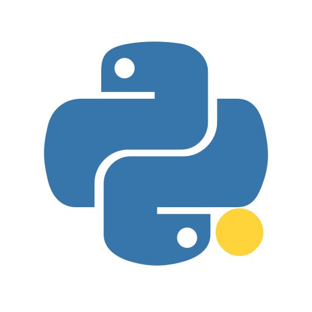
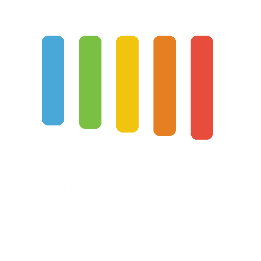

<!-- All text is selectable; images are limited to the portrait and icons. -->
<h1>Alexander Lewdanski</h1>

  
  Age: 27 · Brest, Belarus

  <strong>QA Automation Engineer</strong> 
  5+ years

<h2>Contacts</h2>
<!-- Zero-height wrapping spans keep native text in two columns without table borders. -->

  <a href="mailto:alexander.lewdanski@gmail.com">alexander.lewdanski@gmail.com</a> <a href="https://www.linkedin.com/in/alexander-lewdanski/">LinkedIn</a><picture></picture><picture></picture><a href="tel:+375259663388">+375(25)966-33-88</a> <a href="https://t.me/Lewdanski">Telegram</a><picture></picture>

<h2>About me</h2>

QA Automation Engineer with 5+ years of experience in software testing, including manual, functional, UI, integration, and automated regression testing.

I focus on end-to-end test automation for banking and financial applications using Python, pytest, Selenium WebDriver, and Playwright. I design and maintain tests for business-critical workflows, expand regression coverage, and improve the reliability of automated checks.

My work includes requirements analysis, test planning, test scenario design, test data preparation, defect reporting, and functional and integration testing. I investigate test failures, stabilize flaky UI tests, analyze application logs in Graylog, and verify integrations between the frontend, backend services, and databases.

I also support test environments and automated test execution in CI/CD using Jenkins and Jenkins Pipeline, with results reported in Allure.

<h2>Tools and technologies</h2>

  
  
  
  
  
  
  
  
  
  
  
  
  
  

<h2>Skills</h2>
<ul>
  <li><strong>Test Automation:</strong> Python, pytest, Selenium WebDriver, Playwright, Page Object Model, XPath</li>
  <li><strong>Testing:</strong> UI, API, functional, integration, regression</li>
  <li><strong>CI/CD &amp; Reporting:</strong> Jenkins, Pipeline scripts, Allure</li>
  <li><strong>Databases:</strong> Oracle Database, MySQL, SQL</li>
  <li><strong>Version Control:</strong> Mercurial, TortoiseHG</li>
  <li><strong>Tools:</strong> Chrome DevTools, Postman, Charles Proxy, Fiddler, Graylog</li>
  <li><strong>OS:</strong> Mac OS, iOS, Windows, Android</li>
  <li><strong>English level:</strong> Pre-Intermediate (A2)</li>
</ul>

<h2>Work experience</h2>
<h3><a href="https://itworks.by/">ITWorks &#8599;</a></h3>

Brest, Belarus

<ul>
  <li><strong>QA Automation Engineer</strong> Oct. 2025 - Present</li>
  <li><strong>QA Engineer</strong> June 2020 - Sep. 2024</li>
</ul>

<h2>Education</h2>
<h3><a href="https://www.bsuir.by/">Belarusian State University of Informatics and Radioelectronics &#8599;</a></h3>

<strong>Electronic Marketing</strong> Sep. 2016 - June 2020

<h2>Certifications</h2>
<table>
  <thead><tr><th scope="col">Certificate</th><th scope="col">Provider</th><th scope="col">Year</th></tr></thead>
  <tbody>
    <tr><td><a href="https://www.coursera.org/account/accomplishments/specialization/V3S50AQYI3LH">Google IT Automation with Python &#8599;</a></td><td>Google</td><td>2026</td></tr>
    <tr><td><a href="https://www.coursera.org/account/accomplishments/verify/S9QYZRP3YJ4G">Playwright Python and Pytest for Web Automation Testing &#8599;</a></td><td>Packt</td><td>2026</td></tr>
    <tr><td><a href="https://www.coursera.org/account/accomplishments/verify/F5UXZV04K8A7">Oracle Autonomous Database Professional &#8599;</a></td><td>Oracle</td><td>2026</td></tr>
    <tr><td><a href="https://www.coursera.org/account/accomplishments/verify/VU8ZGBEQQYIR">AI Fundamentals &#8599;</a></td><td>Google</td><td>2026</td></tr>
    <tr><td><a href="https://www.linkedin.com/learning/certificates/66590d932f8864699cdb13df53a309dd82b253730eaaa713e3bee0b5afe72c4a/">Test Automation Foundations &#8599;</a></td><td>LinkedIn Learning</td><td>2023</td></tr>
    <tr><td><a href="https://www.linkedin.com/learning/certificates/9f6be4bc46e3d393cf79c957b5be7c41408c4cce6772f363444c6618d6e9aaca/">Scripting for Testers &#8599;</a></td><td>LinkedIn Learning</td><td>2023</td></tr>
    <tr><td><a href="https://www.linkedin.com/learning/certificates/ce85f2fc33595df70ce8e4a5855b8508d8268a66f08140540f04dd96ef641cc6/">Postman Essential Training &#8599;</a></td><td>LinkedIn Learning</td><td>2023</td></tr>
    <tr><td><a href="https://www.linkedin.com/learning/certificates/991876d1e7a9b89f41ea26dd14518580f028ca7cec6b61e8e3682ff0435cb72b/">Jenkins Essential Training &#8599;</a></td><td>LinkedIn Learning</td><td>2023</td></tr>
    <tr><td><a href="https://coursera.org/share/4e5cccf8bda89d863d7d0b46bc521994">Performance Testing with JMeter &#8599;</a></td><td>Coursera</td><td>2023</td></tr>
    <tr><td><a href="https://gb.ru/certificates/606488">Object Oriented Programming &#8599;</a></td><td>GeekBrains</td><td>2019</td></tr>
    <tr><td><a href="https://new2.test-planet.by/baza-dannyh-vypusknikov/?prowp_nonce_field=55d6c1b4d5&amp;_wp_http_referer=%2Fbaza-dannyh-vypusknikov%2F%3Fprowp_nonce_field%3D55d6c1b4d5%26family%3D%25D0%259B%25D0%25B5%25D0%25B2%25D0%25B4%25D0%25B0%25D0%25BD%25D1%2581%25D0%25BA%25D0%25B8%25D0%25B9%26number%3D2734%26submitted%3Dtrue&amp;family=%D0%9B%D0%B5%D0%B2%D0%B4%D0%B0%D0%BD%D1%81%D0%BA%D0%B8%D0%B9&amp;number=2736&amp;submitted=true">Software Testing Fundamentals &#8599;</a></td><td>QA Academy</td><td>2019</td></tr>
  </tbody>
</table>
